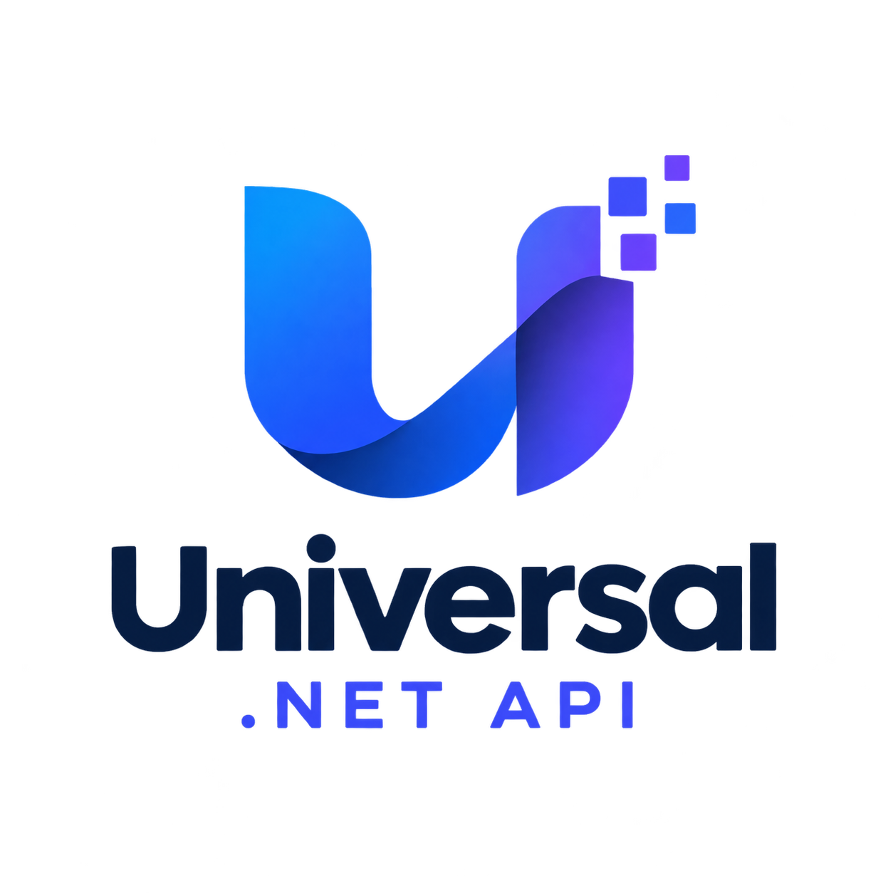
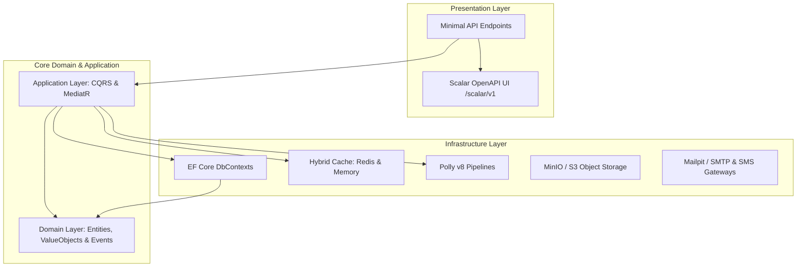

<div align="center">



# 🌐 UNIVERSAL .NET API KERNEL
### Enterprise-Grade Clean Architecture • Modular Monolith & Microservices Engine

[](#)
[](#)
[](#)
[](#)
[](#)
[](#)
[](#)

<p align="center">
  A battle-tested, modular enterprise backend kernel built on <b>Domain-Driven Design (DDD)</b>, <b>Clean Architecture</b>, and <b>CQRS</b>.<br>
  Run it as a single high-performance <b>Modular Monolith</b> or deploy each module as an independent <b>Microservice</b>.
</p>

[Quick Start](#-quick-start--deployment) •
[Modules Overview](#-modular-ecosystem-take-what-you-need) •
[Architecture](#-architectural-overview) •
[Docker Guide](#-docker-compose--environment-configuration) •
[Documentation](docs/deployment-and-env.md)

</div>

---

## 💡 The Genesis: From Student Information System (OBS) to a Universal Enterprise Kernel

> [!NOTE]
> **Why are there references to `obs-` in container names or namespaces?**  
> This project originally started as an enterprise **Student Information System (Öğrenci Bilgi Sistemi - OBS)**. During architecture evolution, all core foundations (authentication, WebAuthn passkeys, omni-channel notifications, object storage, transactional outbox, resilience, scheduling, webhooks, audit logs, and internationalization) were decoupled into clean, autonomous vertical slices.  
> 
> Today, this repository is a **Universal Modular Enterprise Kernel**. It can be used as the backbone for:
> - 🎓 **Student Information Systems (OBS)** & Educational Portals
> - 🏢 **ERP & CRM Backends**
> - 💳 **Fintech & Banking Platforms**
> - 🚀 **Multi-Tenant SaaS Products**
> - 🛒 **E-Commerce & Logistics Engines**
> 
> *You can take the entire kernel or plug individual modules directly into your existing infrastructure.*

---

## 🏛️ Architectural Overview

The solution adheres strictly to **Clean Architecture** boundaries enforced by automated architecture tests (`NetArchTest.Rules`):



---

## 🗂️ Modular Ecosystem (At a Glance)

Before inspecting individual source files or directories, use this quick executive summary to see what each module provides out-of-the-box:

| Module | Core Purpose & Capabilities | Supported Providers & Engines | Standalone Docs |
|---|---|---|---|
| **📁 Files** | Multi-target file storage, chunked uploads, SHA-256 deduplication, access authorization & streaming | **Local Physical Disk**, **AWS S3**, **MinIO S3** | [📖 Read Guide](docs/modules/files.md) |
| **📬 Notifications** | Responsive HTML card template engine (OTP code or button link), brand customization, multi-channel delivery | **SMTP (Mailpit)**, **HTTP SMS Gateways**, Console Fallback | [📖 Read Guide](docs/modules/notifications.md) |
| **🛡️ Security** | Biometric & hardware passwordless authentication, asymmetric RSA token signing, session lifecycle & revocation | **FIDO2 / WebAuthn**, **RSA JWT**, Sliding Refresh Tokens | [📖 Read Guide](docs/modules/security.md) |
| **🌐 Translations** | Dynamic multilingual localization catalog with automatic fallback to Turkish for missing keys | In-Memory, **Redis L2 Cache**, TR / EN / DE / RU | [📖 Read Guide](docs/modules/translations.md) |
| **📝 Auditing** | Tamper-resistant mutation logs, entity before/after states, actor client IP, OpenTelemetry correlation | Dedicated Database, **OpenTelemetry TraceId** | [📖 Read Guide](docs/modules/auditing.md) |
| **📨 Messaging** | Transactional Outbox Pattern for guaranteed at-least-once message delivery, asynchronous dispatcher | **RabbitMQ**, MassTransit, EF Core Outbox | [📖 Read Guide](docs/modules/messaging.md) |
| **⏰ Scheduling** | Enterprise background job scheduler, 5-field cron recurring jobs, one-shot delayed executions | Background Worker Engine, Execution Logs | [📖 Read Guide](docs/modules/scheduling.md) |
| **🔗 Webhooks** | Real-time outbound HTTP event dispatcher, cryptographic payload signatures, automatic retries | **HMAC-SHA256**, Exponential Backoff, Secret Rotation | [📖 Read Guide](docs/modules/webhooks.md) |
| **📊 Import & Export** | Asynchronous background batch file processing, real-time progress polling, row-level validation errors | **CSV**, **Excel (XLSX)** | [📖 Read Guide](docs/modules/import-export.md) |
| **🧱 BuildingBlocks** | Shared Domain & Application primitives, Polly v8 resilience pipelines, hybrid caching, OpenAPI Scalar UI | **Polly v8**, **Redis + Memory Cache**, **Scalar UI** | [📖 Read Guide](docs/modules/building-blocks.md) |

---

### 📑 Detailed Module Breakdown (Click to Expand Tabs)

Each module is completely decoupled with its own Domain, Application, Infrastructure, and API projects. **Click each tab below to explore features, configuration, and standalone usage:**

<details open>
<summary><b>🛡️ 1. Security Module (Passkeys, RSA JWT, Sessions)</b></summary>
<br>

> **Standalone Documentation:** [`docs/modules/security.md`](docs/modules/security.md)

- **🔑 FIDO2 / WebAuthn Passkeys**: Native passwordless login (Touch ID, Face ID, Windows Hello, YubiKeys).
- **🛡️ Asymmetric RSA JWT**: Access tokens signed via private keys and verified via public keys.
- **🔄 Secure Refresh Tokens & Sessions**: Remote session revocation and device management.
- **👥 Claims-Based RBAC**: Fine-grained role and permission management.

```csharp
// Program.cs
builder.Services.AddSecurityApplication();
builder.Services.AddSecurityInfrastructure(builder.Configuration);
app.MapSecurityEndpoints();
```
</details>

<details>
<summary><b>📬 2. Notifications Module (Templated Email, SMS Gateways, OTP)</b></summary>
<br>

> **Standalone Documentation:** [`docs/modules/notifications.md`](docs/modules/notifications.md)

- **📧 Responsive HTML Email Templates**: Pre-configured responsive card templates supporting verification codes (OTP) and action buttons.
- **🎨 Brand Customization**: Externalized configuration for logos, brand accent colors, support links, and addresses.
- **📱 SMS Gateway Integration**: Send verification SMS or system broadcast alerts with provider-agnostic HTTP and Console adapters.
- **🔄 Lifecycle & Resilient Retries**: Manage message statuses (`Pending`, `Sent`, `Failed`, `Cancelled`) with automated retries.

```csharp
// Program.cs
builder.Services.AddNotificationsApplication();
builder.Services.AddNotificationsInfrastructure(builder.Configuration);
app.MapNotificationsEndpoints();
```
</details>

<details>
<summary><b>📁 3. Files Module (AWS S3, MinIO, Local Disk, Chunked Upload)</b></summary>
<br>

> **Standalone Documentation:** [`docs/modules/files.md`](docs/modules/files.md)

- **☁️ Multi-Provider Storage**: Switch between AWS S3 / MinIO and Local Disk via `appsettings.json` or `.env`.
- **🔒 SHA-256 Checksums**: Automated file integrity verification and duplicate detection.
- **🛡️ Access Authorization**: Configurable role and owner-based download permissions.
- **📦 Memory-Efficient Streaming**: Zero-buffer streaming for multi-gigabyte uploads and downloads.

```csharp
// Program.cs
builder.Services.AddFilesApplication();
builder.Services.AddFilesInfrastructure(builder.Configuration);
app.MapFilesEndpoints();
```
</details>

<details>
<summary><b>🌐 4. Translations Module (Multi-Language Catalog & Fallback)</b></summary>
<br>

> **Standalone Documentation:** [`docs/modules/translations.md`](docs/modules/translations.md)

- **🌍 Supported Languages**: Turkish (`TR`), English (`EN`), German (`DE`), and Russian (`RU`).
- **🔄 Automatic Fallback**: Missing language keys automatically fall back to Turkish without throwing errors.
- **⚡ In-Memory & Redis Caching**: Sub-millisecond localized key lookups.

```csharp
// Program.cs
builder.Services.AddTranslationsApplication();
builder.Services.AddTranslationsInfrastructure(builder.Configuration);
app.MapTranslationsEndpoints();
```
</details>

<details>
<summary><b>📝 5. Auditing Module (Structured Audit Trail & Trace Linkage)</b></summary>
<br>

> **Standalone Documentation:** [`docs/modules/auditing.md`](docs/modules/auditing.md)

- **📊 Comprehensive Change History**: Records actor ID, entity name, previous/new JSON states, and client IP.
- **🔍 Distributed Tracing Correlation**: Directly correlated with OpenTelemetry `Activity.Current.TraceId`.
- **🛡️ Dedicated Database Isolation**: Isolated storage to prevent tampering.

```csharp
// Program.cs
builder.Services.AddAuditingApplication();
builder.Services.AddAuditingInfrastructure(builder.Configuration);
app.MapAuditingEndpoints();
```
</details>

<details>
<summary><b>📨 6. Messaging Module (Transactional Outbox Pattern)</b></summary>
<br>

> **Standalone Documentation:** [`docs/modules/messaging.md`](docs/modules/messaging.md)

- **📬 Transactional Outbox Pattern**: Guarantees zero message loss by committing domain events within the business transaction.
- **🔄 Asynchronous Worker**: Background dispatcher polls pending messages and pushes to message brokers (RabbitMQ).
- **🛡️ Idempotency Verification**: Built-in deduplication keys.

```csharp
// Program.cs
builder.Services.AddMessagingApplication();
builder.Services.AddMessagingInfrastructure(builder.Configuration);
app.MapMessagingEndpoints();
```
</details>

<details>
<summary><b>⏰ 7. Scheduling Module (Background Jobs & Cron Engine)</b></summary>
<br>

> **Standalone Documentation:** [`docs/modules/scheduling.md`](docs/modules/scheduling.md)

- **⏱️ Standard 5-Field Cron**: Run recurring background routines using expressions like `*/15 * * * *`.
- **⏳ One-Shot Delayed Tasks**: Execute tasks at future timestamps.
- **⚡ On-Demand Triggers & History**: Manually invoke tasks and inspect execution logs.

```csharp
// Program.cs
builder.Services.AddSchedulingApplication();
builder.Services.AddSchedulingInfrastructure(builder.Configuration);
app.MapSchedulingEndpoints();
```
</details>

<details>
<summary><b>🔗 8. Webhooks Module (HMAC-SHA256 Signatures & Delivery Retries)</b></summary>
<br>

> **Standalone Documentation:** [`docs/modules/webhooks.md`](docs/modules/webhooks.md)

- **🔐 Cryptographic HMAC Signatures**: Payload authenticity verification via `X-Webhook-Signature`.
- **🔄 Zero-Downtime Secret Rotation**: Rotate endpoint credentials without service interruption.
- **⚡ Exponential Backoff Retries**: Automatic delivery retries with full HTTP audit trail.

```csharp
// Program.cs
builder.Services.AddWebhooksApplication();
builder.Services.AddWebhooksInfrastructure(builder.Configuration);
app.MapWebhooksEndpoints();
```
</details>

<details>
<summary><b>📊 9. Import & Export Module (Async CSV/Excel Ingestion)</b></summary>
<br>

> **Standalone Documentation:** [`docs/modules/import-export.md`](docs/modules/import-export.md)

- **⚡ Asynchronous File Ingestion**: Large CSV/XLSX imports process in the background without blocking requests.
- **📈 Real-Time Progress Tracking**: Polling endpoints report completed percentage and row counts.
- **🛡️ Row-Level Validation**: Pinpoints exact invalid rows and validation errors.

```csharp
// Program.cs
builder.Services.AddImportExportApplication();
builder.Services.AddImportExportInfrastructure(builder.Configuration);
app.MapImportExportEndpoints();
```
</details>

<details>
<summary><b>🧱 10. BuildingBlocks (Shared Kernel & Resilience Bedrock)</b></summary>
<br>

> **Standalone Documentation:** [`docs/modules/building-blocks.md`](docs/modules/building-blocks.md)

- **🏛️ Domain Primitives**: Base `Entity<T>`, `ValueObject`, `IDomainEvent`, and `Result<T>`.
- **🛡️ Polly v8 Resilience**: Unified circuit breakers, rate limiters, retries with jitter, and timeouts.
- **⚡ Hybrid Caching (`ICacheService`)**: Transparent L1 memory + L2 Redis caching.
- **📖 Scalar OpenAPI Engine**: Rich, interactive API docs out of the box at `/scalar/v1`.

```csharp
// Program.cs
builder.Services.AddOpenApiWithScalar();
builder.Services.AddHybridCaching(builder.Configuration);
builder.Services.AddResiliencePipelines();
app.MapOpenApiWithScalar();
```
</details>

---

## 🚀 Quick Start & Deployment

### 1. Clone & Prepare Environment Variables

Copy the template `.env.example` into `.env` on your deployment server or local development machine:

```bash
# Clone repository
git clone https://github.com/your-org/universal-api-kernel.git
cd universal-api-kernel

# Copy example environment configuration
cp docker/.env.example docker/.env
```

> [!TIP]
> Edit `docker/.env` to configure database passwords, JWT private key, S3 bucket settings, and SMS/SMTP provider credentials.

---

## 🐳 Docker Compose & Environment Configuration

The solution features clean separation between **Infrastructure Services** (Databases, Caches, Storage) and **Application Services** (APIs):

### Step 1: Start Infrastructure Services
```bash
docker compose -f docker/docker-compose.infra.yml up -d
```

This starts:
- 🗄️ **Microsoft SQL Server 2022** on `localhost:1433`
- 🐘 **PostgreSQL 16** on `localhost:5432`
- ⚡ **Redis Cache** on `localhost:6379`
- ☁️ **MinIO S3 Object Storage** on `localhost:9000` (Console: `localhost:9001`)
- 📧 **Mailpit SMTP Server** on `localhost:1025` (Web Inbox: `localhost:8025`)

### Step 2: Start Application Services

#### Option A: Unified Modular Monolith (Recommended)
Run the all-in-one **Bootstrapper** container hosting all modules in a single process:
```bash
docker compose -f docker/docker-compose.app.yml up -d obs-bootstrapper
```
- **API Base URL:** `http://localhost:5000`
- **Scalar Interactive Documentation:** `http://localhost:5000/scalar/v1`

#### Option B: Standalone Microservices
Launch all modules as independent microservices:
```bash
docker compose -f docker/docker-compose.app.yml up -d
```
Each service exposes its own isolated Scalar UI:
| Microservice | Port | Scalar Documentation |
|---|---|---|
| **Security API** | `5001` | `http://localhost:5001/scalar/v1` |
| **Files API** | `5002` | `http://localhost:5002/scalar/v1` |
| **Notifications API** | `5003` | `http://localhost:5003/scalar/v1` |
| **Translations API** | `5004` | `http://localhost:5004/scalar/v1` |
| **Auditing API** | `5005` | `http://localhost:5005/scalar/v1` |
| **Messaging API** | `5006` | `http://localhost:5006/scalar/v1` |
| **Scheduling API** | `5007` | `http://localhost:5007/scalar/v1` |
| **Webhooks API** | `5008` | `http://localhost:5008/scalar/v1` |
| **Import & Export API** | `5009` | `http://localhost:5009/scalar/v1` |

---

## 🧪 Automated Testing & Architecture Verification

The solution includes a comprehensive suite of unit, integration, and architectural rule tests:

```bash
dotnet test
```

```
Toplam 1 test dosyası belirtilen desenle eşleşti.
Başarılı!  - Başarısız: 0, Başarılı: 104, Atlanan: 0, Toplam: 104
```

- **Domain Isolation Tests**: Verifies domain projects never reference infrastructure, persistence, or API projects.
- **CQRS Handler Tests**: Verifies commands, queries, and business rules across all modules.

---

## 🤖 AI-Assisted Engineering & Disclaimers

- **AI Pair Programming**: This architecture, design patterns, and domain implementations were actively co-engineered using **Google Gemini** (DeepMind Antigravity) and **OpenAI ChatGPT**.
- **Logo Disclaimer**: The project logo was generated using ChatGPT (DALL-E) as an open-source visual symbol and does not represent a registered corporate trademark.

---

## 📄 License
This project is licensed under the [MIT License](LICENSE).
