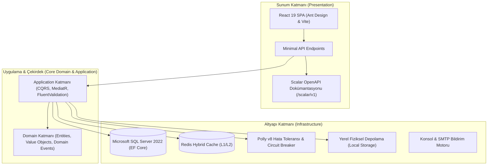

# 🎓 Üniversite Öğrenci Bilgi ve Yönetim Sistemi (OBS / ÜBYS)
### Enterprise-Grade Clean Architecture • Modular Monolith • Domain-Driven Design (DDD) • React 19 SPA

[](#)
[](#)
[](#)
[](#)
[](#)
[](#)
[](#)
[](#)

<p align="center">
  Üniversitelerin tüm akademik, idari, öğrenci ve personel süreçlerini modern yazılım mühendisliği ilkeleriyle uçtan uca yöneten; <b>Domain-Driven Design (DDD)</b>, <b>Clean Architecture</b>, <b>CQRS</b> ve <b>Modular Monolith</b> mimarisine sahip yeni nesil kurumsal Üniversite Bilgi Yönetim Sistemi (ÜBYS).
</p>

---

## 🏛️ Mimari Vizyon ve İlkeler

Bu sistem sıradan bir CRUD uygulaması değildir. Üniversite organizasyon yapısı, fakülteler, bölümler, müfredat sürümleri, dersler, öğretim elemanları, öğrenci kayıtları, ders seçimleri, şubeleşme, çan eğrisi notlandırma ve idari teşkilat birbiriyle yüksek tutarlılık içinde çalışır.



### 📐 Temel Mühendislik Kuralları
1. **Vertical Slice & Clean Architecture:** Domain katmanı kesinlikle EF Core, HTTP, JWT veya dış altyapılara bağımlı değildir.
2. **Rich Domain Model:** Üniversite iş kuralları (AKTS sınırları, önkoşullar, harç kontrolü, çan eğrisi hesaplamaları) controller veya handler içerisine dağıtılmamış, Aggregate Root ve Domain Entity nesnelerinde kapsüllenmiştir.
3. **CQRS & MediatR:** Her kullanım senaryosu bağımsız bir Command/Query ve Handler üzerinden yürütülür.
4. **İşlemsel Bütünlük (Transactional Outbox):** Kritik durum değişiklikleri domain event olarak veritabanı işlemiyle atomik kaydedilir ve kayıpsız dağıtılır.
5. **Modüler Monolit:** Tüm akademik ve idari modüller `obs-bootstrapper` içerisinde tek bir yüksek performanslı serviste çalışır; istendiğinde bağımsız mikroservis olarak da ölçeklenebilir.

---

## 🧭 Fonksiyonel Modüller & Özellikler

### 1. 🏛️ Akademik Yapı & Müfredat Kataloğu
* **Fakülte ve Bölüm Teşkilatı:** Üniversiteye bağlı fakülteler, enstitüler, meslek yüksekokulları ve bölümlerin hiyerarşik yönetimi. Fakülte kurarken öğretim üyeleri listesinden dekan seçimi.
* **Müfredat Sürümleri & AKTS:** Bölümlere ait dönemlik ders planları, zorunlu/seçmeli havuzlar, ders kodu, teorik-pratik saatler, yerel kredi ve AKTS sınırları (dönemlik 30-45 AKTS esnek limit ayarları).
* **Önkoşul Zincirleri:** Bir dersin alınabilmesi için önceki dönemlerden başarılması gereken önkoşul derslerinin mantıksal kontrolü.

### 2. 👨‍🎓 Kullanıcı & Nüfus Masası
* **Asil Öğrenci Masası:** Örgün lisans, ön lisans ve lisansüstü öğrencilerin T.C. Kimlik / YKN doğrulama, öğrenci numarası üretimi, sınıf/dönem takibi, danışman öğretim üyesi ataması ve ilişik kesme/mezuniyet durumları.
* **Misafir & Değişim Öğrencileri:** **Erasmus+**, **Farabi**, **Mevlana** ve **Özel Öğrenci** statüsündeki öğrencilerin geldiği üniversite, misafir öğrenci numarası ve intibak protokolü takibi.
* **Eğitmen & Akademisyen Masası:** Öğretim üyeleri ve araştırma görevlilerinin akademik kadro kayıtları, unvan yönetimi (Prof. Dr., Doç. Dr., Dr. Öğr. Üyesi, Arş. Gör., Öğr. Gör. veya Unvansız).

### 3. 🔬 Öğrenim, Yayın & Araştırma Masası (Akademik Profil)
YÖKSİS ve AVESİS standartlarında, her akademisyenin detaylı profilini ve bilimsel çıktılarını içeren sekmeli (tabbed) yönetim:
* **Açık Erişim Rozetleri:** Doğrulanmış **ORCID ID** bağlantısı, **Google Scholar Profil Linki**, **YÖKSİS Araştırmacı Numarası**, **Scopus ID** ve Kişisel Web Sayfası.
* **Öğrenim Bilgileri:** Lisans, Yüksek Lisans, Doktora dereceleri, üniversite, fakülte, mezuniyet yılı, tez konusu ve tez danışmanı.
* **Makaleler:** SCI-Expanded, SSCI, Scopus ve TR Dizin indeksli makaleler, yayın yılı, cilt/sayı, sayfa aralığı, **tıklanabilir DOI linki** ve **tam metin web bağlantısı**.
* **Kitaplar & Kitap Bölümleri:** Telif kitap, bölüm yazarlığı, çeviriler, yayınevi, basım yılı, **ISBN numarası** ve doğrudan kitap erişim linki.
* **Bildiriler:** Ulusal/uluslararası kongre sunumları (Sözlü/Poster), kongre şehri, tarihi ve bildiri kitapçığı bağlantısı.
* **Projeler & Ar-Ge:** TÜBİTAK (1001, 1002, 3501), BAP, AB Horizon, Erasmus+ ve Sanayi projeleri; proje rolü (Yürütücü/Araştırmacı), bütçe ve durum.
* **Verilen Dersler & Danışmanlıklar:** Yürütülen ders yükü ve yönetilen yüksek lisans/doktora tezleri.

### 4. 🏢 İdari Teşkilat & Personel Masası
Kullanıcı yönetiminden tamamen ayrılmış bağımsız idari yapılanma:
* **İdari Birimler Masası:** Daire Başkanlıkları (Öğrenci İşleri D.B., Bilgi İşlem D.B., Personel D.B., SKS), Genel Sekreterlik, Koordinatörlükler, Fakülte/Enstitü Sekreterlikleri, birim amirleri, dahili telefon ve yerleşke binaları.
* **İdari Kadro Unvanları:** Devlet memurları ve sözleşmeli personel kadroları (Daire Başkanı, Şube Müdürü, Şef, Memur, Bilgisayar İşletmeni, V.H.K.İ., Tekniker vb.), hizmet sınıfları (GİH, TH, SH, YH) ve hiyerarşi sıralaması.
* **Yetki & Sistem Rolleri:** Öğrenci İşleri Yöneticisi, Harç ve Mali İşler Sorumlusu, Not/Transkript Onay Yetkilisi gibi esnek yetki kutucuklarıyla donatılmış rol şablonları.
* **İdari Personel Kadrosu:** Yeni personel tanımlanırken birim, kadro unvanı ve sistem rolü serbest metin olarak değil, doğrudan tanımlı teşkilat listelerinden seçilir.

### 5. 📚 Ders Seçimi, Dönemlik Şube Açımları & Haftalık Program
* **Şubeleşme (Sections):** Derslerin A, B, C şubeleri olarak açılması, kontenjan tanımları, şubeye öğretim elemanı ve derslik atanması.
* **İnteraktif Ders Kayıt (Ekle-Bırak):** Öğrencilerin dönem başında ders seçmesi, çakışma (time collision) ve kontenjan kontrolleri, danışman onayı akışı.
* **Haftalık Ders Çizelgesi:** Öğrenci ve eğitmen bazında gün/saat/derslik matrisi.

### 6. 📝 Sınav, Değerlendirme & Bağıl Notlandırma (Çan Eğrisi)
* **Esnek Değerlendirme Planı:** Vize (%40), Final (%60), Proje, Kısa Sınav (Quiz) ve Laboratuvar ağırlıkları.
* **Bağıl Değerlendirme Sistemi (BDS - Çan Eğrisi):** Sınıf ortalaması, standart sapma ve T-Skoru hesaplamalarıyla dinamik harf notu (AA, BA, BB, CB, CC, DC, DD, FD, FF) dağılımı.
* **Transkript & GANO:** 4.00 üzerinden Dönem Ağırlıklı Not Ortalaması (DNO) ve Genel Ağırlıklı Not Ortalaması (GANO) hesaplamaları, resmi transkript dökümü.

### 7. 🛡️ Güvenlik, Kimlik & Giriş Deneyimi
* **e-Devlet & obsKimlik:** Kurumsal giriş sayfasında standart şifreli girişin yanında **e-Devlet Kapısı** ve **obsKimlik** entegrasyonu.
* **FIDO2 / WebAuthn Biyometrik Giriş (Passkeys):** Touch ID, Face ID ve Windows Hello ile şifresiz, güvenli donanımsal kimlik doğrulama.
* **Asimetrik RSA-256 JWT & Oturum Yönetimi:** Özel anahtarla imzalanan tokenlar, cihaz takibi ve anlık uzaktan oturum sonlandırma.
* **Giriş Ekranı Özelleştirme:** Öğrenci işlerinin giriş arkaplan resimlerini yükleyebildiği, slayt süresini ve geçiş animasyonunu ayarlayabildiği dinamik yapı.

---

## 🛠️ Teknoloji Yığını

| Katman | Teknoloji / Kütüphane | Açıklama |
|---|---|---|
| **Backend Framework** | .NET 10 & C# 13 | Yüksek performanslı Minimal API ve Modular Monolith mimarisi |
| **ORM & Persistence** | Entity Framework Core 10 | Microsoft SQL Server 2022 sağlayıcısı (`UseSqlServer`) |
| **CQRS & Mediator** | MediatR 12 | Komut ve sorgu ayrımı, Pipeline Behaviors |
| **Doğrulama & Kurallar** | FluentValidation | Request ve Domain doğrulama kuralları |
| **Resilience & Fault Tolerance** | Polly v8 | Circuit Breaker, Retry with Jitter, Timeout, Rate Limiting |
| **Önbellek (Caching)** | Redis + In-Memory | İki seviyeli (L1/L2) hibrit önbellek mekanizması |
| **Dokümantasyon** | Scalar OpenAPI UI | Modern, interaktif API test konsolu (`/scalar/v1`) |
| **Frontend Framework** | React 19 & TypeScript | Hızlı ve güvenli modern Single Page Application (SPA) |
| **UI Bileşen Kütüphanesi** | Ant Design (antd v6) | Kurumsal standartlarda zengin masa ve tablo bileşenleri |
| **Tasarım & Stil** | Tailwind CSS & Vanilla CSS | Modern, responsive, koyu/açık tema ve slayt animasyonları |
| **Derleme & Paketleme** | Vite 8 | Ultra hızlı modül yükleme ve optimize üretim derlemesi |

---

## 🚀 Hızlı Başlangıç & Çalıştırma

### 1. Depoyu Klonlayın
```bash
git clone https://github.com/ismailcanuslu/ogrenci-bilgi-sistemi.git
cd ogrenci-bilgi-sistemi
```

### 2. Kaynak Dostu Docker Altyapısını Başlatın (Önerilen)
Sistem kaynaklarını (RAM & CPU) korumak için gereksiz PostgreSQL, MinIO ve Mailpit servisleri devre dışı bırakılmış olup, yalnızca **MSSQL (SQL Server) ve Redis** ayağa kalkar:

```bash
docker compose -f docker/docker-compose.infra.yml up -d
```
*Bu komutla:*
* 🗄️ **Microsoft SQL Server 2022:** `localhost:1433` (Kullanıcı: `sa`, Şifre: `Password123!`)
* ⚡ **Redis Cache:** `localhost:6379`
kullanıma hazır hale gelir.

### 3. Backend API'yi Çalıştırın (.NET Modular Monolith)
```bash
dotnet run --project src/Bootstrapper/Bootstrapper.csproj
```
* **API Adresi:** `http://localhost:5050`
* **Scalar İnteraktif Dokümantasyon:** `http://localhost:5050/scalar/v1`

### 4. Frontend SPA Portalı Çalıştırın (React 19 + Ant Design)
```bash
cd src/Clients/react-web-app
npm install
npm run dev
```
* **OBS Web Portalı:** `http://localhost:5173`

---

## 🧪 Testler & Mimari Doğrulama

Sistem, katmanlar arası bağımlılık kurallarını ve domain mantığını sürekli sınayan 100+ otomatik test barındırır:

```bash
dotnet test
```
* **Domain İzolasyon Testleri (`NetArchTest`):** Domain katmanının dış projelere, EF Core veya HTTP kütüphanelerine referans vermediğini matematiksel olarak doğrular.
* **CQRS Handler Testleri:** Akademik kayıt, notlandırma ve yetkilendirme komutlarının beklenen sonuçları verdiğini doğrular.

---

## 👥 Kullanıcı Rolleri ve Demo Yetkileri
Sisteme giriş yaparken test edebileceğiniz kurumsal roller:
* **Öğrenci (STUDENT):** Ders kayıt, transkript görüntüleme, harç ve başvuru işlemleri.
* **Öğretim Üyesi (ACADEMIC):** Not girişi, şube yönetimi, akademik profil ve araştırma çıktıları.
* **Öğrenci İşleri Masası (STAFF):** Öğrenci kayıt, fakülte/bölüm yönetimi, AKTS limitleri ve idari teşkilat.
* **Sistem Yöneticisi (ADMIN):** Yetki şablonları, sistem rolleri ve genel kurumsal parametreler.

---

## 📄 Lisans
Bu proje [MIT Lisansı](LICENSE) kapsamında açık kaynak olarak lisanslanmıştır.
